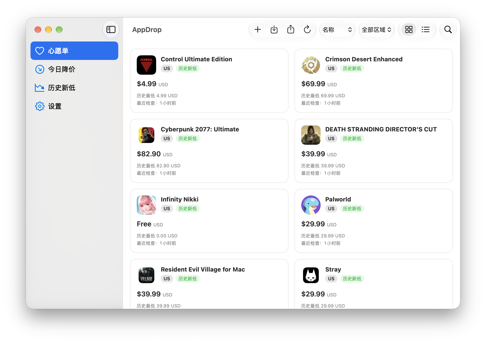

# AppDrop

<p>
  <a href="README.md">简体中文</a> | <a href="README_EN.md">English</a>
</p>

> 面向 macOS 用户的 App Store 价格追踪工具。追踪多商店区域的应用价格，查看历史走势与历史新低，并在降价时通过系统通知提醒你。


## 功能特性

- 🔍 **多区域追踪**：支持 US、HK、JP、CN 四个商店区域，每个追踪项目独立对应一个区域
- 📈 **价格历史**：阶梯折线图展示完整价格走势（Swift Charts）
- 🏷️ **历史新低**：自动识别并标记历史最低价
- 🔔 **本地通知**：降价时发送系统通知（主 App 与后台 Helper 各自独立请求权限）
- 🔄 **后台自动检查**：通过 SMAppService + launchd 按天调度，执行后退出，不常驻内存
- 📋 **Wishdrop 心愿单**：通过 `.wishdrop` 文件格式导入和导出追踪列表
- 🔗 **两种添加方式**：粘贴 App Store 链接 或 关键词搜索（支持 Mac / iPhone·iPad 两个目录）

## 截图



## 技术栈

| 组件 | 技术 |
|------|------|
| 语言 / UI | Swift 6 + SwiftUI（macOS 14.0+）|
| 图表 | Swift Charts（`.stepEnd` 阶梯折线）|
| 持久化 | SwiftData（App Group 共享库，主 App 与 Helper 共用一份数据库）|
| 后台调度 | ServiceManagement / `SMAppService.agent(plistName:)` + launchd |
| 通知 | UserNotifications |
| 网络 | URLSession（iTunes Search / Lookup API）|
| 工程 | XcodeGen（`project.yml`）+ SwiftPM 本地包 `SharedKit` |
| 测试 | Swift Testing（66 个测试用例）|

## 目录结构

```
AppDrop.xcodeproj            # 由 xcodegen 生成（勿手改，修改 project.yml 后重新生成）
project.yml                  # 工程定义（targets / 签名 / 复制阶段 / Info.plist）
AppDrop/                     # 主应用（App / Views / ViewModels / Resources / entitlements）
AppDropHelper/               # 后台助手（LSUIElement，main.swift + launchd plist）
SharedKit/                   # 共享 SwiftPM 包（Models / Services / Data / Utilities + Tests）
Scripts/                     # 辅助脚本（图标生成、可分享构建打包）
screenshots/                 # README 截图
```

## 快速开始

### 环境要求

- macOS 14.0 或更高版本
- Xcode 15 或更高版本（含命令行工具）
- [XcodeGen](https://github.com/yonaskolb/XcodeGen)：`brew install xcodegen`

### 构建运行

```bash
# 1. 克隆仓库
git clone https://github.com/aiwentongxue/AppDrop.git
cd AppDrop

# 2. 生成 Xcode 工程
xcodegen generate

# 3. 运行单元测试（离线，不依赖真实价格）
swift test --package-path SharedKit

# 4. Debug 构建
xcodebuild -project AppDrop.xcodeproj -scheme AppDrop -configuration Debug \
  -derivedDataPath /private/tmp/AppDrop-DD -allowProvisioningUpdates build

# 5. Release 构建（Universal：arm64 + x86_64）
xcodebuild -project AppDrop.xcodeproj -scheme AppDrop -configuration Release \
  -derivedDataPath /private/tmp/AppDrop-Release-DD -allowProvisioningUpdates build
```

### 首次启动授权

本项目使用个人团队证书签名，App Group 容器受 TCC 保护。首次启动时若出现"无法打开共享数据库"，请：

1. 打开「系统设置 → 隐私与安全性 → 完全磁盘访问权限」
2. 添加 **AppDrop** 与 **AppDrop Helper** 并将开关拨到打开
3. 重新启动应用

## 后台任务工作方式

- 主 App 通过 `SMAppService.agent(plistName: "com.appdrop.helper.plist")` 注册 `AppDropHelper`，plist 内嵌于 `Contents/Library/LaunchAgents/`。
- Helper 默认带 `--scheduled` 参数运行：距上次尝试不足 20 小时则跳过；`--run-now` 可强制执行；完成写库与通知后正常退出，不常驻、不轮询。
- `StartInterval = 86400` 为"尽力调度"，Mac 休眠/关机期间不保证执行，醒来后由逾期判断补跑。

## 通知权限

macOS 通知权限按进程独立：

- **AppDrop（主应用）**：首次启动引导中申请，手动刷新触发的通知使用该权限。
- **AppDrop Helper（后台助手）**：首次后台运行时独立申请，launchd 触发的通知使用该权限。若被拒绝，可在「系统设置 → 通知 → AppDrop Helper」中开启。

## Wishdrop 格式

追踪列表可导出为 `.wishdrop` 文件（JSON），在不同设备或用户间共享。

## App Group 与共享数据库

- App Group：`group.com.appdrop.shared`
- 数据库路径：`~/Library/Group Containers/group.com.appdrop.shared/AppDrop/AppDrop.store`
- 主 App 与 Helper 使用完全一致的 ModelConfiguration，容器解析失败时明确报错，不静默回退到私有数据库。
- 跨进程写入通过 `flock` 咨询锁串行化，价格记录含幂等标记，防止重复通知。

## 搜索说明

"添加应用 → 搜索"提供 **Mac** 与 **iPhone·iPad** 两个目录选项，默认 Mac：

- Mac 目录使用 `entity=macSoftware` + `kind` 过滤；iPhone/iPad 使用 `entity=software`。
- Apple 搜索索引存在盲区（部分新上架 Mac 游戏搜不到），此类应用请用 App Store 链接添加。

## 已知限制

| 限制 | 说明 |
|------|------|
| 签名与公证 | 当前为个人团队签名，未做 Developer ID 签名与公证，仅适合本机开发使用 |
| 后台调度精度 | `StartInterval` 不保证准时；休眠/关机期间可能错过或延迟检查 |
| 汇率换算 | 不做汇率换算，不合并不同区域的最低价；同一应用不同区域为独立追踪项 |
| 降价定义 | "较上次降价"基于两次有效价格之差，不是商店官方促销折扣 |
| 数据迁移 | 追踪数据存于本机 App Group 容器，迁移请使用导出/导入心愿单功能 |

## 贡献

欢迎提交 Issue 和 Pull Request。提交 PR 前请确保 `swift test --package-path SharedKit` 通过。

## License

GNU General Public License v3.0 (GPL-3.0) — 详见 [LICENSE](LICENSE) 文件。
Copyright (C) 2026 我是艾文喵
