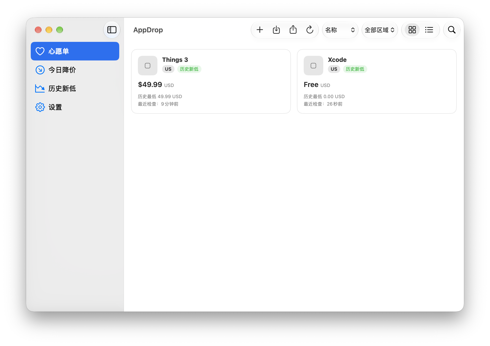
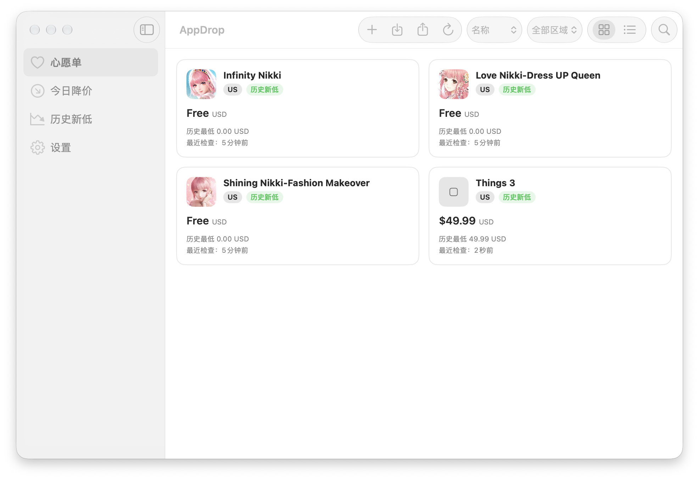
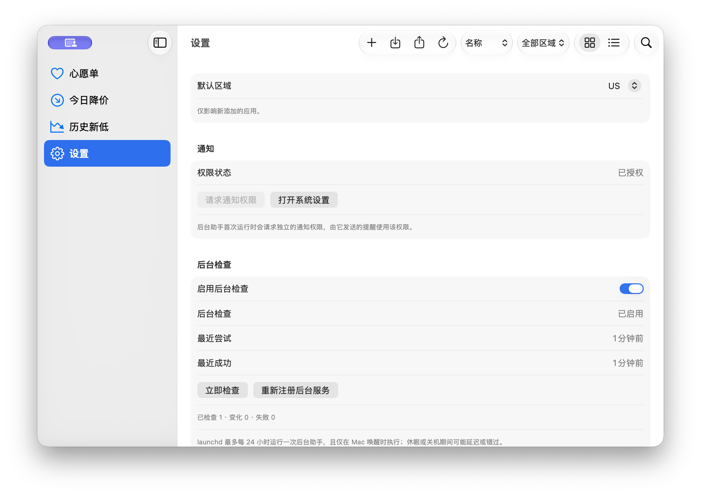

# AppDrop

> A native macOS App Store price tracker. Monitor app prices across multiple storefronts, view price history and all-time lows, and get notified when prices drop.


## Features

- 🔍 **Multi-storefront tracking** — Track prices across US, HK, JP, and CN; each tracked item is tied to a specific storefront.
- 📈 **Price history chart** — Step-line chart powered by Swift Charts (`.stepEnd` interpolation).
- 🏷️ **All-time low detection** — Automatically identifies and badges all-time low prices.
- 🔔 **Local notifications** — Sends a system notification when a price drops (main App and background Helper each request their own permission).
- 🔄 **Background checks** — Scheduled via SMAppService + launchd; the Helper runs, writes to the database, sends notifications, then exits — no persistent process.
- 📋 **Wishdrop format** — Import and export your tracking list as a `.wishdrop` file (JSON).
- 🔗 **Two ways to add apps** — Paste an App Store link or search by keyword (Mac and iPhone·iPad catalogs supported).

## Screenshots

| Main Window | Price Chart | Settings |
|-------------|-------------|----------|
|  |  |  |

## Tech Stack

| Component | Technology |
|-----------|------------|
| Language / UI | Swift 6 + SwiftUI (macOS 14.0+) |
| Charts | Swift Charts (`.stepEnd` step-line) |
| Persistence | SwiftData (App Group shared database, used by both App and Helper) |
| Background scheduling | ServiceManagement / `SMAppService.agent(plistName:)` + launchd |
| Notifications | UserNotifications |
| Networking | URLSession (iTunes Search / Lookup API) |
| Project | XcodeGen (`project.yml`) + local SwiftPM package `SharedKit` |
| Tests | Swift Testing (66 test cases) |

## Repository Structure

```
AppDrop.xcodeproj            # Generated by XcodeGen (do not edit; regenerate from project.yml)
project.yml                  # Project definition (targets, signing, copy phases, Info.plist)
AppDrop/                     # Main app (App / Views / ViewModels / Resources / entitlements)
AppDropHelper/               # Background helper (LSUIElement, main.swift + launchd plist)
SharedKit/                   # Shared SwiftPM package (Models / Services / Data / Utilities + Tests)
Documentation/               # Build guide, background helper, Wishdrop format, test report
Scripts/                     # Helper scripts (icon generation, shareable build packaging)
dist/                        # Build artifacts (.zip + SHA-256 checksums)
```

## Getting Started

### Requirements

- macOS 14.0 or later
- Xcode 15 or later (with Command Line Tools)
- [XcodeGen](https://github.com/yonaskolb/XcodeGen): `brew install xcodegen`

### Build & Run

```bash
# 1. Clone the repository
git clone https://github.com/aiwentongxue/AppDrop.git
cd AppDrop

# 2. Generate the Xcode project
xcodegen generate

# 3. Run unit tests (offline, no real prices required)
swift test --package-path SharedKit

# 4. Debug build
xcodebuild -project AppDrop.xcodeproj -scheme AppDrop -configuration Debug \
  -derivedDataPath /private/tmp/AppDrop-DD -allowProvisioningUpdates build

# 5. Release build (Universal: arm64 + x86_64)
xcodebuild -project AppDrop.xcodeproj -scheme AppDrop -configuration Release \
  -derivedDataPath /private/tmp/AppDrop-Release-DD -allowProvisioningUpdates build
```

For detailed instructions including signing, installation, and troubleshooting, see [Documentation/build-and-run.md](Documentation/build-and-run.md).

### First-Launch Permission

This project is signed with a personal-team certificate. The App Group container is protected by TCC. If the app shows "Cannot open shared database" on first launch:

1. Open **System Settings → Privacy & Security → Full Disk Access**
2. Add **AppDrop** and **AppDrop Helper**, then toggle them on
3. Relaunch the app

## How Background Checks Work

- The main app registers `AppDropHelper` via `SMAppService.agent(plistName: "com.appdrop.helper.plist")`; the plist is embedded at `Contents/Library/LaunchAgents/`.
- The Helper runs with `--scheduled` by default: it skips if fewer than 20 hours have passed since the last attempt. Use `--run-now` to force an immediate run. After writing to the database and sending notifications, it exits — no persistent polling.
- `StartInterval = 86400` is a best-effort target; the Helper may run late after sleep or shutdown, and will catch up via the overdue-check logic.

See [Documentation/background-helper.md](Documentation/background-helper.md) for full details.

## Notification Permissions

macOS grants notification permissions per process identity:

- **AppDrop (main app)** — Requested during onboarding. Notifications from manual refreshes use this permission.
- **AppDrop Helper (background)** — Requested independently on first run. Notifications from launchd-scheduled checks use this permission. If denied, enable it in **System Settings → Notifications → AppDrop Helper**.

## Wishdrop Format

Your tracking list can be exported as a `.wishdrop` file (JSON) to share across devices or with other users. See [Documentation/wishdrop-format.md](Documentation/wishdrop-format.md) for the schema.

## App Group & Shared Database

- App Group ID: `group.com.appdrop.shared`
- Database path: `~/Library/Group Containers/group.com.appdrop.shared/AppDrop/AppDrop.store`
- Both the main app and the Helper use identical `ModelConfiguration`; if the container cannot be resolved, the app reports an error rather than silently falling back to a private database.
- Cross-process writes are serialized with an `flock` advisory lock; price records carry an idempotent `notifiedAt` flag to prevent duplicate notifications.

## Search Notes

"Add App → Search" offers **Mac** and **iPhone·iPad** catalog options (Mac is the default):

- Mac catalog: uses `entity=macSoftware` with additional `kind` filtering.
- iPhone·iPad catalog: uses `entity=software`.
- Apple's search index has gaps (some recently released Mac titles are missing). For those apps, add them via their App Store link instead.

## Known Limitations

| Limitation | Details |
|------------|---------|
| Code signing | Signed with a personal-team certificate; not Developer ID signed or notarized — suitable for local/development use only |
| Background schedule accuracy | `StartInterval` is not a strict guarantee; the Helper may be delayed if the Mac is asleep or shut down |
| Currency conversion | No exchange-rate conversion; prices across different storefronts are not compared or merged |
| Discount definition | "Price drop" means the new price is lower than the previous recorded price — not an official App Store promotional discount |
| Data migration | Tracking data lives in the local App Group container; use export/import Wishdrop to migrate between machines |

## Contributing

Issues and pull requests are welcome. Please make sure `swift test --package-path SharedKit` passes before submitting a PR.

## License

MIT License — see the [LICENSE](LICENSE) file for details.
